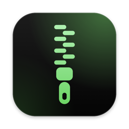
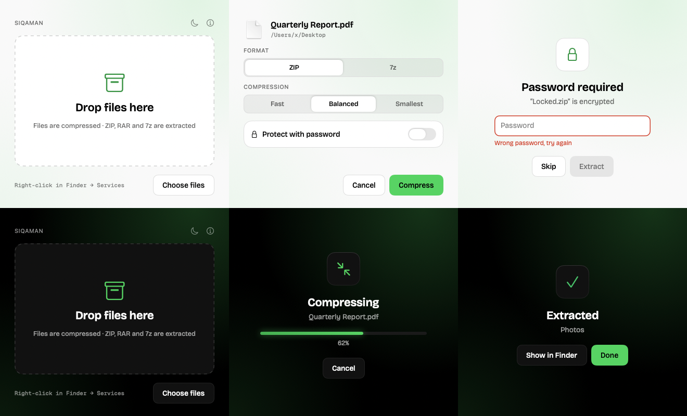

<p align="center">
  
</p>

<h1 align="center">Siqaman</h1>

<p align="center">
  <a href="https://t.me/ertagakech">
    <picture>
      <source media="(prefers-color-scheme: dark)" srcset="docs/ertagakech-logo-white.svg">
      
    </picture>
  </a>
</p>

<p align="center">
  A fast, native archiver for macOS: ZIP, RAR and 7z, with password protection, right from Finder.
</p>

<p align="center">
  <a href="https://github.com/anvarnarz/siqaman/releases/latest/download/Siqaman.zip"><b>⬇ Download for macOS</b></a>
  &nbsp;·&nbsp; Apple silicon · macOS 15+
</p>

<p align="center">
  
</p>

## Features

- **Extract** ZIP, RAR, RAR5, 7z, tar, gz, bz2, xz, zst, cab, iso and more.
- **Compress** to ZIP or 7z with AES-256 password protection. 7z can also hide file names.
- **Right-click in Finder** → Services → *Compress with Siqaman…* / *Extract with Siqaman*.
- **Smart extraction:** results land next to the archive, a single top-level folder isn't double-nested, `.tar.gz` unpacks in one go, and existing files are never overwritten.
- **Safe by default:** passwords never appear in the process list, and files from downloaded archives stay quarantined so Gatekeeper still checks them.
- Light and dark mode, drag and drop, live progress with cancel.

## Install

1. [Download Siqaman.zip](https://github.com/anvarnarz/siqaman/releases/latest/download/Siqaman.zip), unzip it, and move **Siqaman.app** to **Applications**.
2. Open it once. The app isn't notarized, so macOS blocks the first launch: go to **System Settings → Privacy & Security** and click **Open Anyway**.
3. Right-click any file in Finder → **Services**. If the Siqaman items are missing, enable them in **System Settings → Keyboard → Keyboard Shortcuts → Services → Files and Folders**.

To make Siqaman the default for an archive type: Finder → Get Info on an archive → **Open with** → Siqaman → **Change All**.

## Build from source

Needs Command Line Tools (`xcode-select --install`) and Homebrew's 7-Zip:

```bash
brew install sevenzip
```

```bash
./build.sh
```

This compiles the app, bundles `7zz`, signs it ad-hoc, and installs it to `/Applications`. Use `./build.sh --no-install` to only build into `build/`.

Run the engine self-test:

```bash
swiftc -parse-as-library -enable-bare-slash-regex -swift-version 5 Sources/Siqaman/Archiver.swift scripts/selftest.swift -o build/selftest && build/selftest
```

## Formats

| | Create | Extract | Password |
|---|---|---|---|
| ZIP | ✓ | ✓ | AES-256 |
| 7z | ✓ | ✓ | AES-256, optional encrypted names |
| RAR / RAR5 | — | ✓ | ✓ |
| tar, gz, bz2, xz, zst, cab, iso… | — | ✓ | — |

RAR is a proprietary format, so Siqaman can open RAR files but not create them.

## Project structure

```
Sources/Siqaman/
  SiqamanApp.swift   app entry, windows, Finder services
  Model.swift        UI state machine (compose → working → password → done)
  ContentView.swift  SwiftUI screens + About window
  Theme.swift        Ertaga kech design tokens (light + dark)
  Archiver.swift     7zz wrapper: compress, extract, progress, password detection
Resources/           Info.plist, fonts, wordmark
scripts/             icon.swift (draws the app icon), selftest.swift
build.sh             build, bundle, sign, install
```

## Credits

Archiving by [7-Zip](https://www.7-zip.org) (`7zz`, LGPL-2.1 with the unRAR restriction), bundled in the app. Fonts: Bricolage Grotesque and Geist Mono, both under the SIL Open Font License 1.1.

---

<p align="center">
  Made by Anvar Narzullaev<br><br>
  <a href="https://t.me/ertagakech">
    <picture>
      <source media="(prefers-color-scheme: dark)" srcset="docs/ertagakech-logo-white.svg">
      
    </picture>
  </a><br>
  <a href="https://t.me/ertagakech">t.me/ertagakech</a>
</p>
